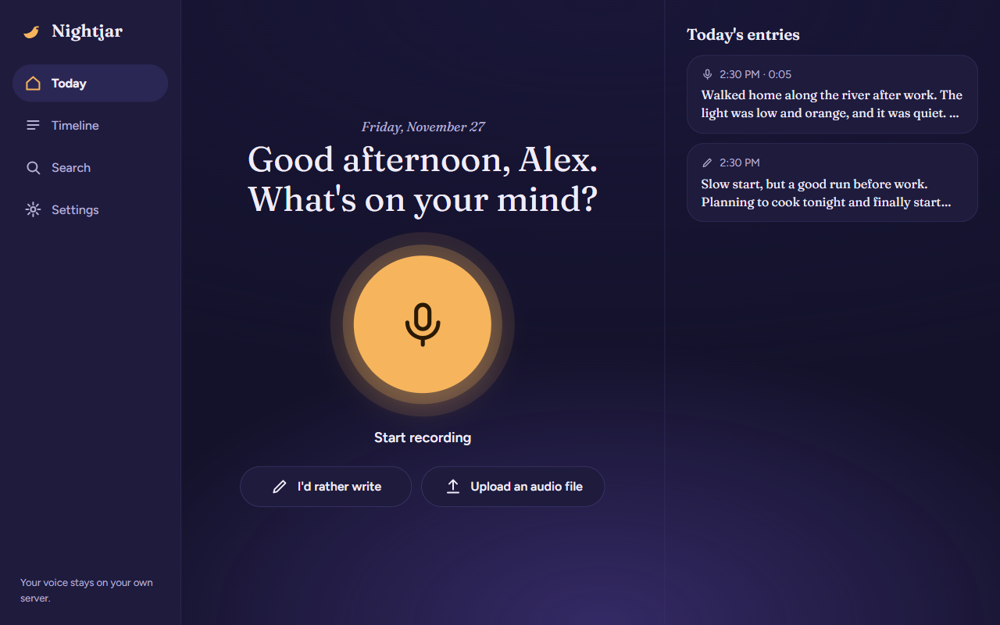

<p align="center">
  
</p>

# Nightjar

*Verba volant, scripta manent.* Spoken words fly away, written words remain.

**A self-hosted voice journal.** Speak or type, and your own server turns it into searchable text, fully offline.

[](https://github.com/porsk/nightjar/actions/workflows/ci.yml)
[](https://github.com/porsk/nightjar/releases)
[](https://hub.docker.com/r/porsk/nightjar)
[](https://hub.docker.com/r/porsk/nightjar)
[](LICENSE)



*Nightjar 0.2.0*

- **Speak or type.** One tap to record in the browser, or just write. Hungarian and English.
- **Transcribed offline on your server.** Whisper speech to text runs in your own container. No cloud needed.
- **Your data stays yours.** Self-hosted, private by design, no telemetry. AI is opt-in and off by default.

## Why Nightjar?

The nightjar is a bird that wakes up at dusk and sings through the night, the hour when many of us finally think back
over the day. A jar is where you keep good things safe, like your own words. *Verba volant, scripta manent*: what you
say flies away, what you write stays. Nightjar keeps it, on your own server.

> **Status: early but usable.** Latest release is [0.2.0](https://github.com/porsk/nightjar/releases). It is pre-1.0,
> so expect changes. Back up your data before you upgrade, see the [backup guide](docs/backup.md). Follow the
> [roadmap](docs/roadmap.md).

## Features

A private audio diary for your homelab: Docker, one Postgres, an installable web app (PWA) for phone and desktop.
Hungarian and English (recordings and UI) today, more languages possible later.

| Feature | Status |
|---|---|
| Setup and sign-in with a username | ✅ |
| Text entries with Markdown | ✅ |
| Record in the browser, or upload an audio file (up to 3 hours) | ✅ |
| Offline transcription with Whisper, Hungarian and English, with live status | ✅ |
| Editable transcripts and audio playback | ✅ |
| Timeline and Home | ✅ |
| Search across entries and transcripts, with Hungarian word endings and accent-free matching | ✅ |
| Settings, Hungarian and English UI | ✅ |
| Installable app (PWA) | ✅ |
| Logs, health checks, Prometheus metrics, backup guide | ✅ |
| Photos, mood, tags and filters | planned (M2) |
| Multiple journals, favourites, calendar and gentle stats | planned (M2) |
| Prompts and look-backs ("on this day") | planned (M2) |
| Optional AI suggestions: summary, tags, people, places (Claude or a local Ollama model) | planned (M3) |
| MCP server so your AI assistant can read your journal when you allow it | planned (M3) |
| Offline recording queue, then 1.0 | planned (M4) |

## Quick start

You need Docker. It runs fine on a small home server. Transcription needs about 2 GB of RAM while it works.
Releases are published to Docker Hub as `porsk/nightjar`.

```
cd docker
cp .env.example .env     # set POSTGRES_PASSWORD
docker compose up -d
```

`docker/compose.yaml` uses `porsk/nightjar:latest`. To upgrade only when you choose, pin a version such as
`porsk/nightjar:0.2.0`.

1. Open http://localhost:3000.
2. The first start prints a setup code. Get it with `docker compose logs nightjar`.
3. Create your account, then turn on transcription in Settings. That downloads the speech model (about 560 MB) once.

Putting it on a domain behind Traefik and Cloudflare? See the [self-hosting guide](docs/self-hosting.md). Data lives in
the `nightjar-data` and `nightjar-db` volumes. Back them up: see the [backup guide](docs/backup.md).

## Docs

[Plan on one page](https://github.com/porsk/nightjar/blob/main/docs/plan-summary.md) ·
[Roadmap](https://github.com/porsk/nightjar/blob/main/docs/roadmap.md) ·
[Product](https://github.com/porsk/nightjar/blob/main/docs/product.md) ·
[Architecture](https://github.com/porsk/nightjar/blob/main/docs/architecture.md) ·
[Design](https://github.com/porsk/nightjar/blob/main/docs/design.md) ·
[Decisions](https://github.com/porsk/nightjar/blob/main/docs/decisions.md)

## Development

```
pnpm install
pnpm dev      # server on :3000, web app on :5173
```

See [CONTRIBUTING.md](https://github.com/porsk/nightjar/blob/main/CONTRIBUTING.md). To report a security problem, see
[SECURITY.md](https://github.com/porsk/nightjar/blob/main/SECURITY.md).

## License

[AGPL-3.0](https://github.com/porsk/nightjar/blob/main/LICENSE)
